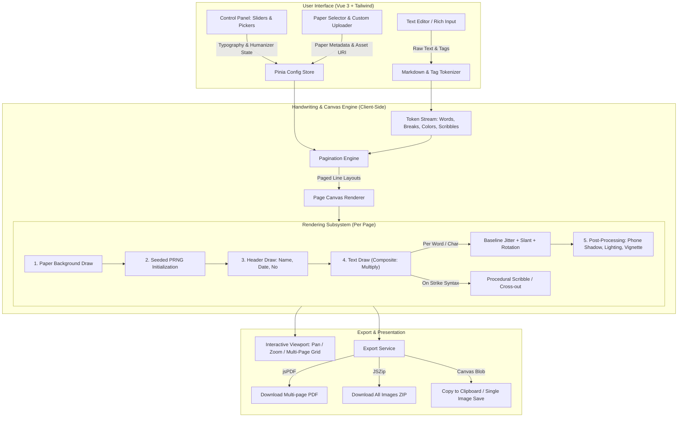

# Architectural Blueprint & Master Implementation Plan: Next-Gen BotNulis (Text-to-Handwriting)

A high-performance, 100% client-side Text-to-Handwriting web application built with **Vue 3**, **Vite**, **TypeScript**, **Tailwind CSS**, and **HTML5 Canvas 2D API**, designed for seamless serverless deployment on **Vercel**.

---

## 1. Executive Summary & System Philosophy

### 1.1 The Problem with Legacy "Bot Nulis"
Earlier generation Bot Nulis implementations (Python Pillow, P5.js, or server-side headless browsers) suffered from fatal design flaws:
1. **Server Bottlenecks:** Every keypress or page generation required HTTP roundtrips, clogging backend workers and crashing under viral traffic spikes.
2. **Artificial "Uncanny Valley" Aesthetics:** Text lines were mathematically straight, character spacing was strictly monospace/proportional without variance, and color was solid hex code (`#000000`), immediately alerting educators and anti-plagiarism screeners.
3. **Single-Page Truncation:** Documents exceeding one page had their excess text clipped or dropped completely.
4. **Zero Physical Environmental Context:** Output images looked like digital PDF vector mockups rather than photographs taken with a smartphone in ambient room lighting.

### 1.2 The Next-Gen Solution
Next-Gen BotNulis is engineered from the ground up to be:
* **Zero-Server Overhead:** 100% computed on the client GPU/CPU via native Canvas 2D and Web Workers.
* **Deterministic Pseudo-Random Humanizer:** Uses seeded PRNG (`Mulberry32`) to inject organic irregularities (baseline bounce, rotational drift, margin fatigue, pen pressure) without "character jumping" on re-renders.
* **Photorealistic Ink-Paper Synthesis:** `multiply` composite operations let scanned paper fibers, grain, and notebook grid lines show through ink strokes.
* **Automated Lookahead Pagination:** Text streams seamlessly across unlimited notebook pages.
* **Camera & Environmental Post-Processing:** Simulates realistic phone camera shadows, ambient lighting color temperature, and perspective tilts.
* **Vercel Zero-Config Deployment:** Static SPA architecture with offline PWA readiness and zero ongoing server hosting costs.

---

## 2. Tech Stack Specification

| Category | Technology | Rationale / Purpose |
|---|---|---|
| **Framework** | **Vue 3 (v3.5+)** | Composition API (`<script setup>`), reactivity system with fine-grained shallowRefs for high-frequency canvas updates. |
| **Language** | **TypeScript (v5.5+)** | Strict type safety for canvas coordinate models, paper schemas, AST tokens, and export buffers. |
| **Build Tool** | **Vite (v6+)** | Sub-second HMR, optimized tree-shaking, fast asset bundling. |
| **State Management** | **Pinia (v2.2+)** | Centralized reactive stores for paper templates, typography parameters, text content, and export queues. |
| **Persistence** | **Pinia Plugin Persistedstate + LocalForage / IndexedDB** | Preserves user drafts, custom uploaded fonts, and paper templates across sessions without storage quota failures. |
| **Styling & UI Components** | **Tailwind CSS (v3.4+) + Radix Vue / Lucide Icons** | High-density controls panel (sliders, segmented pickers, collapsible accordions) with dark/light mode. |
| **Utilities** | **@vueuse/core** | `useStorage`, `useDebounceFn`, `useDevicePixelRatio`, `useFileDialog`, `useFullscreen`. |
| **PDF Generation** | **jsPDF (v2.5+)** | Compiles multi-canvas pages into multi-page PDF documents with custom DPI/page dimension preservation. |
| **Archive Bundling** | **JSZip (v3.10+) + FileSaver** | Bundles multi-page outputs into a single downloadable `.zip` of high-res JPEGs/PNGs. |
| **Math / Symbols (Optional)** | **KaTeX (v0.16+)** | Offscreen HTML-to-canvas rendering for mathematical equations and formulas. |
| **Testing Framework** | **Vitest (v2.1+) + Playwright** | Fast unit testing for typography/math algorithms + full headless E2E testing for canvas image generation and export. |
| **Deployment Target** | **Vercel** | Edge CDN distribution, instant preview deployments, zero server maintenance. |

---

## 3. System Architecture & Data Flow



---

## 4. Deep-Dive: Core Algorithmic Mechanics

### 4.1 Paper Template Specification & Coordinate Mapping
Every paper type is defined by a precision metadata schema:

```typescript
export interface PaperTemplate {
  id: string;
  name: string;
  category: 'notebook' | 'folio' | 'binder' | 'hvs' | 'grid';
  imageUrl: string;
  width: number;        // Native pixel width of scanned paper (e.g., 1440)
  height: number;       // Native pixel height of scanned paper (e.g., 1920)
  marginTop: number;    // Y coordinate of first usable blue ruling line
  marginBottom: number; // Y coordinate where writing must stop before bottom footer
  marginLeft: number;   // X coordinate after red vertical margin line
  marginRight: number;  // X coordinate before right edge border
  lineHeight: number;   // Distance in float pixels between adjacent lines (e.g., 42.5)
  baselineOffset: number; // Fine offset to snap font baseline exactly onto the printed line
  headerFields?: {
    name?: { x: number; y: number; label?: string };
    date?: { x: number; y: number; label?: string };
    subject?: { x: number; y: number; label?: string };
    pageNumber?: { x: number; y: number; label?: string };
  };
}
```

#### Crucial Canvas Baseline Snapping
In standard HTML canvas, `ctx.textBaseline = 'top'` aligns text to the top of the line, which causes handwriting to float awkwardly.
In BotNulis Next-Gen:
* Set `ctx.textBaseline = 'alphabetic'`.
* The line Y coordinate represents the printed paper ruling.
* Letters with descenders (`g`, `y`, `p`, `q`, `j`) naturally drop **below** the ruling line, while standard glyphs (`a`, `e`, `m`, `x`) sit directly on the line—matching genuine human handwriting physics.

---

### 4.2 Seeded PRNG & Deterministic Humanizer Engine
To prevent "dancing text" (where typing a letter at the bottom of the page causes all previous lines to randomly jump and re-jitter):
* We employ a **Seeded PRNG (Mulberry32)** initialized with a document-wide seed combined with each word's positional index `(pageIndex * 10000 + lineIndex * 100 + wordIndex)`.

```typescript
export function createPRNG(seed: number) {
  let s = seed >>> 0;
  return function () {
    s = (s + 0x6d2b79f5) >>> 0;
    let t = Math.imul(s ^ (s >>> 15), 1 | s);
    t = (t + Math.imul(t ^ (t >>> 7), 61 | t)) ^ t;
    return ((t ^ (t >>> 14)) >>> 0) / 4294967296;
  };
}
```

#### Humanizer Parameter Matrix
| Parameter | Range | Mathematical Model / Logic |
|---|---|---|
| **Baseline Jitter ($Y$)** | `-2.0px` to `+2.0px` | `dy = (prng() - 0.5) * 2 * jitterIntensity` |
| **Word Spacing Jitter ($X$)** | `0.7x` to `1.3x` space width | `spacing = baseSpaceWidth * (1 + (prng() - 0.5) * spacingIntensity)` |
| **Character Rotation** | `-1.2°` to `+1.2°` | Rotates canvas matrix around word center before rendering. |
| **Margin Drift (Hand Fatigue)** | `0px` to `8px` | `drift = sin(lineIndex * 0.4) * marginDriftFactor + (lineIndex * fatigueSlope)` |
| **Ink Flow / Pressure Drift** | `0.85` to `1.0` alpha | Simulates pen running slightly drier or wetter at stroke segments. |
| **Slant Drift** | `-2°` to `+4°` | Slight global tilt with micro-variance across paragraphs. |

---

### 4.3 Rich Syntax Tokenizer & Procedural Scribble ("Fitur Coretan")
Human handwriting frequently includes mistakes, scratched-out words, and highlighted key terms. BotNulis implements a lightweight inline token parser:

* `~~kata salah~~` $\rightarrow$ Render word, then execute procedural jagged scribble lines across word bounding box:
  ```typescript
  function drawScribble(ctx: CanvasRenderingContext2D, x: number, y: number, width: number, height: number, prng: () => number) {
    ctx.save();
    ctx.beginPath();
    ctx.strokeStyle = ctx.fillStyle;
    ctx.lineWidth = 1.8 + prng() * 0.8;
    const passes = 3;
    for (let p = 0; p < passes; p++) {
      let curX = x - 2;
      let curY = y - height * 0.3 + (prng() - 0.5) * 4;
      ctx.moveTo(curX, curY);
      while (curX < x + width + 2) {
        curX += 4 + prng() * 4;
        curY += (prng() - 0.5) * 6;
        ctx.lineTo(curX, curY);
      }
    }
    ctx.stroke();
    ctx.restore();
  }
  ```
* `[red]teks penting[/red]` $\rightarrow$ Switches active ink color to Ballpoint Red (`#9c1c1c`).
* `[blue]teks biru[/blue]` $\rightarrow$ Switches active ink color to Standard Pilot Blue (`#1a3365`).
* `==highlight kuning==` $\rightarrow$ Draws translucent yellow marker rectangle behind text with `globalCompositeOperation = 'multiply'` and rounded stroke corners.

---

### 4.4 Pagination & Word-Wrapping Engine
Since Canvas lacks native block text layout, our engine performs a two-stage measure-and-fit algorithm:
1. **Tokenization:** Breaks raw text into lines (by `\n`), then lines into words and tokens.
2. **Width Measurement:** Calculates cumulative line width using `ctx.measureText(token.text).width` plus jittered spacing.
3. **Line Boundary Check:** If `currentX + wordWidth > marginRight`, wrap to next line:
   - `currentX = marginLeft + getMarginDrift(lineIndex)`
   - `currentY += lineHeight`
4. **Page Boundary Check:** If `currentY + lineHeight > marginBottom`:
   - Push current line array to `Page[currentPageIndex]`.
   - Increment `currentPageIndex`.
   - Reset `currentY = marginTop`.
   - Allocate new page layout.

---

### 4.5 Environmental Post-Processing & Realistic Camera Mode
To make output look indistinguishable from a smartphone camera shot:
1. **Multiply Paper Blending:**
   `ctx.globalCompositeOperation = 'multiply'` binds ink particles into paper grain.
2. **Ambient Room Light Gradient:**
   Radial gradient overlay simulating warm overhead bulb or daylight:
   `createRadialGradient(cx, cy, 100, cx, cy, radius)` with warm amber tint (`rgba(255, 235, 190, 0.12)`).
3. **Smartphone / Arm Shadow Overlay:**
   Pre-rendered soft-alpha PNG or procedural bezier polygon shadow representing the photographer's head/phone blocking light from top-center.
4. **Surface Vignette & Paper Warping:**
   Slight dark edges (`rgba(0, 0, 0, 0.15)`) and micro subtle 3D perspective tilt (CSS 3D transform for interactive preview; matrix canvas shear on export).

---

## 5. UI/UX Design & Layout Architecture

The application adopts a **Modern Desktop & Mobile-Responsive Split Screen**:

```
+---------------------------------------------------------------------------------------+
|  [Logo] BotNulis Studio v2      [Document Title: Tugas_Fisika]     [Share] [Export v] |
+------------------------------------+--------------------------------------------------+
|  LEFT PANEL (Controls & Input)     |  RIGHT PANEL (Interactive Canvas Viewport)       |
|  [Tabs: Teks | Gaya | Kertas | FX] |                                                  |
|                                    |  [Toolbar: Zoom In/Out | Fit | Page 1 of 3 | <>] |
|  -- TAB: TEKS --                   |                                                  |
|  [Header Fields: Nama, Tgl, No]    |  +--------------------------------------------+  |
|  +-------------------------------+ |  |                                            |  |
|  | Textarea with line counters   | |  |       =============================        |  |
|  | and quick syntax buttons:     | |  |       Nama: Budi Santoso   Tgl: 19/10/26   |  |
|  | [~~Coret~~] [Merah] [Stabilo] | |  |       -----------------------------        |  |
|  |                               | |  |  |    Lorem ipsum dolor sit amet,          |  |
|  | Type your assignment here...  | |  |  |    consectetur adipiscing elit...       |  |
|  +-------------------------------+ |  |  |                                         |  |
|                                    |  |  |                                         |  |
|  -- TAB: GAYA TULISAN --           |  |  | [Realistic Phone Shadow / Lighting]     |  |
|  Font: [Indah Cewek v] [Upload TTF]|  |  |                                         |  |
|  Warna Tinta: [Hitam] [Biru] [Merah]| |  +--------------------------------------------+  |
|  Ukuran Font: [----O-----] 24px    |                                                  |
|  Kerapian:    [-------O--] 85%     |  Filmstrip Thumbnail Navigator:                  |
|  Variasi Jitter: [---O------] 20%  |  [ [Pg 1] ]  [ [Pg 2] ]  [ [Pg 3] ]  [ + Add ]   |
+------------------------------------+--------------------------------------------------+
```

---

## 6. Project Directory & Module Structure

```text
/Users/mss_dev/Projects/BotNulis/
├── .github/
│   └── workflows/
│       └── ci.yml                 # Automated test & typecheck workflow
├── public/
│   ├── assets/
│   │   ├── fonts/                 # Built-in handwriting fonts (.woff2/.ttf)
│   │   │   ├── hand-neat-f.woff2  # Rapi cewek
│   │   │   ├── hand-casual-m.woff2# Cakar ayam santai cowok
│   │   │   ├── hand-cursive.woff2 # Tegak bersambung
│   │   │   └── hand-marker.woff2  # Spidol tebal
│   │   ├── papers/                # High-res paper scans
│   │   │   ├── sidu-38.jpg        # Buku tulis Sinar Dunia 38 lembar
│   │   │   ├── folio-double.jpg   # Double folio bergaris
│   │   │   ├── binder-a5.jpg      # Loose leaf binder A5
│   │   │   ├── hvs-polos.jpg      # Kertas polos HVS
│   │   │   └── grid-kotak.jpg     # Kertas kotak matematika
│   │   └── overlays/              # Environmental textures
│   │       ├── shadow-phone.png   # Bayangan tangan memegang smartphone
│   │       ├── paper-texture.png  # Serat kertas halus
│   │       └── coffee-stain.png   # Noda kopi opsional
│   └── favicon.ico
├── src/
│   ├── assets/
│   │   └── css/
│   │       └── main.css           # Tailwind directives & base styling
│   ├── components/
│   │   ├── common/
│   │   │   ├── BaseSlider.vue     # Reusable custom range slider
│   │   │   ├── ColorPicker.vue    # Ink color selector
│   │   │   └── DropdownSelect.vue # Select dropdown
│   │   ├── editor/
│   │   │   ├── EditorSidebar.vue  # Main left sidebar container with tabs
│   │   │   ├── TextInputTab.vue   # Text input, header inputs, quick formatting buttons
│   │   │   ├── TypographyTab.vue  # Font picker, custom TTF upload, font size, line height
│   │   │   ├── HumanizerTab.vue   # Sliders for jitter, neateness, spacing, fatigue
│   │   │   ├── PaperTab.vue       # Paper template switcher & calibration tool
│   │   │   └── RealismTab.vue     # Camera shadow, lighting temp, 3D tilt controls
│   │   ├── preview/
│   │   │   ├── CanvasViewport.vue # Pan, zoom, responsive canvas wrapper
│   │   │   ├── PageCanvas.vue     # High-DPI Canvas component for individual page
│   │   │   ├── PageNavigator.vue  # Bottom filmstrip & page pagination controls
│   │   │   └── CalibrationOverlay.vue # Visual line-calibration guide for custom papers
│   │   └── export/
│   │       ├── ExportModal.vue    # Export options (PDF, ZIP, single image, DPI quality)
│   │       └── ExportProgress.vue # Progress bar during multi-page rendering
│   ├── composables/
│   │   ├── useCanvasRenderer.ts   # Core draw loop, multi-pass rendering, effects
│   │   ├── useFontLoader.ts       # Dynamic FontFace loading & validation
│   │   ├── useHumanizer.ts        # Seeded PRNG, baseline bounce, jitter algorithms
│   │   ├── usePagination.ts       # Text measuring, line-wrapping, and multi-page splitter
│   │   ├── useRichTokenizer.ts    # Parses strikethrough, color tags, and highlights
│   │   ├── useExporter.ts         # jsPDF, JSZip, and image download pipeline
│   │   └── usePaperCalibration.ts # Helpers to compute line-height and margin coordinates
│   ├── stores/
│   │   ├── documentStore.ts       # Text content, header data, active page
│   │   ├── styleStore.ts          # Font selection, ink color, sizes, humanizer sliders
│   │   ├── paperStore.ts          # Built-in and user-uploaded paper templates
│   │   └── realismStore.ts        # Shadow type, warm lighting, vignette, tilt angles
│   ├── types/
│   │   ├── canvas.ts              # Drawing contexts, render tokens, line layout models
│   │   ├── paper.ts               # Paper template definitions & calibration models
│   │   └── export.ts              # Export formats, DPI configs, progress status
│   ├── utils/
│   │   ├── prng.ts                # Mulberry32 PRNG implementation
│   │   ├── imageProcessing.ts     # Canvas blend utilities, contrast/warmth filters
│   │   └── constants.ts           # Default paper templates & factory presets
│   ├── App.vue
│   └── main.ts
├── tests/
│   ├── unit/
│   │   ├── prng.spec.ts           # Verifies determinism and distribution of PRNG
│   │   ├── tokenizer.spec.ts      # Tests strikethrough, color tag parsing
│   │   ├── pagination.spec.ts     # Verifies text wrapping and page boundary math
│   │   └── fontLoader.spec.ts     # Tests custom font loading and fallbacks
│   ├── integration/
│   │   └── canvasRender.spec.ts   # Headless canvas draw commands and snapshot states
│   └── e2e/
│       ├── typingFlow.spec.ts     # Playwright: Typing generates pages correctly
│       ├── customFont.spec.ts     # Playwright: Uploading TTF updates preview
│       └── exportFlow.spec.ts     # Playwright: Exporting PDF and ZIP blobs
├── package.json
├── tsconfig.json
├── vite.config.ts
├── tailwind.config.ts
├── vercel.json                    # Routing and caching headers for Vercel
└── README.md
```

---

## 7. Master Implementation Checklist & Detailed Tasks

```
[ ] Phase 1: Project Scaffolding & Foundation Setup
    [ ] 1.1 Initialize Vite + Vue 3 + TypeScript project (`npm create vite@latest`)
    [ ] 1.2 Install & configure Tailwind CSS, PostCSS, and Autoprefixer
    [ ] 1.3 Install core libraries: `pinia`, `pinia-plugin-persistedstate`, `@vueuse/core`, `lucide-vue-next`
    [ ] 1.4 Install export & utility packages: `jspdf`, `jszip`, `file-saver`
    [ ] 1.5 Setup Vitest and Playwright test environments
    [ ] 1.6 Configure `vercel.json` for SPA client-side routing & long-cache headers for static paper/font assets
    [ ] 1.7 Implement Pinia stores: `documentStore`, `styleStore`, `paperStore`, `realismStore`
    [ ] 1.8 Create initial responsive UI layout (Editor sidebar + Canvas viewport)

[ ] Phase 2: Core Typography, Font Loader & Canvas Engine
    [ ] 2.1 Collect and curate 4 high-quality open-license handwriting fonts (.woff2)
    [ ] 2.2 Implement `useFontLoader.ts` using native browser `document.fonts.load()` with loading state spinners
    [ ] 2.3 Implement custom `.ttf` / `.woff2` drag-and-drop file uploader with dynamic `FontFace` API registration
    [ ] 2.4 Implement basic `PageCanvas.vue` handling High-DPI screens (`window.devicePixelRatio`)
    [ ] 2.5 Prepare 5 high-resolution paper templates (Sinar Dunia, Folio, Binder A5, HVS, Grid) with calibrated JSON metadata
    [ ] 2.6 Render background paper image onto Canvas preserving native aspect ratio

[ ] Phase 3: Tokenizer, Pagination & Lookahead Wrapping Engine
    [ ] 3.1 Implement `useRichTokenizer.ts` (supports `~~strikethrough~~`, `[red]`, `[blue]`, `==highlight==`)
    [ ] 3.2 Implement `usePagination.ts` word-wrapping logic based on `ctx.measureText()`
    [ ] 3.3 Implement ruled-line snapping: align font alphabetic baseline precisely with paper ruling lines
    [ ] 3.4 Implement multi-page lookahead splitter: push overflowing text to sequential pages
    [ ] 3.5 Implement dynamic page addition/deletion reactivity in Pinia store
    [ ] 3.6 Implement Header drawing (Name, Date, Subject, Page Number) at static coordinates

[ ] Phase 4: Deterministic Humanizer & Ink Blending Engine
    [ ] 4.1 Implement Mulberry32 seeded pseudo-random generator in `prng.ts`
    [ ] 4.2 Implement Baseline Jitter ($Y$ offset per word/character)
    [ ] 4.3 Implement Rotation Jitter (sub-degree rotation matrix per word)
    [ ] 4.4 Implement Spacing & Margin Fatigue Drift (slight margin indent variation down the page)
    [ ] 4.5 Implement Procedural Pen Scribble for `~~crossed-out~~` words (multi-pass erratic bezier paths)
    [ ] 4.6 Implement Ink Pressure variance (subtle opacity and stroke thickness drift)
    [ ] 4.7 Set `ctx.globalCompositeOperation = 'multiply'` to achieve authentic ink-paper fiber blending

[ ] Phase 5: Environmental Post-Processing (Camera / Realism Mode)
    [ ] 5.1 Implement soft smartphone shadow overlay (linear/radial gradient and PNG asset)
    [ ] 5.2 Implement ambient lighting temperature adjustment (warm desk lamp vs daylight sunlight filter)
    [ ] 5.3 Implement paper vignette and border shadow effects
    [ ] 5.4 Implement 3D perspective tilt (CSS 3D transform for live preview, matrix transformation for export)
    [ ] 5.5 Create user presets: "Kamera HP Malam", "Scan Dokumen Rapih", "Fotokopi Agak Miring"

[ ] Phase 6: Export Engine, Quality of Life & Polish
    [ ] 6.1 Implement Single Page export (PNG / JPEG) with custom quality factor
    [ ] 6.2 Implement Multi-Page PDF export using `jsPDF` matching paper dimensions and DPI
    [ ] 6.3 Implement All-Pages ZIP export using `JSZip`
    [ ] 6.4 Implement "Copy Image to Clipboard" using `navigator.clipboard.write()`
    [ ] 6.5 Implement LocalStorage auto-save with draft recovery notification
    [ ] 6.6 Performance optimization: debounced render loop with `requestAnimationFrame` for buttery-smooth typing
    [ ] 6.7 Custom Paper Calibration Tool: interactive modal allowing users to upload their own notebook photo and drag ruler guides to create custom paper JSON templates

[ ] Phase 7: Comprehensive Testing, Hardening & Deployment
    [ ] 7.1 Unit tests: PRNG determinism, tokenizer regex, pagination boundary logic
    [ ] 7.2 Integration tests: Canvas rendering commands verification
    [ ] 7.3 E2E tests: Typing, formatting tags, custom font upload, PDF export
    [ ] 7.4 Cross-browser testing: Safari iOS, Chrome Android, Firefox, macOS Safari
    [ ] 7.5 Build optimization: Asset compression, font subsetting, bundle size < 300KB initial chunk
    [ ] 7.6 Deploy to Vercel and verify edge delivery & cache headers
```

---

## 8. Detailed Testing Strategy & Quality Assurance Matrix

### 8.1 Unit Testing (Vitest)
* **PRNG Stability Test (`tests/unit/prng.spec.ts`):**
  - Verify that `mulberry32(seed)` produces identical numbers across repeated runs.
  - Verify distribution uniformity between `0.0` and `1.0`.
* **Rich Tokenizer Test (`tests/unit/tokenizer.spec.ts`):**
  - Verify `~~word~~` parses into `{ type: 'strikethrough', content: 'word' }`.
  - Verify nested or unclosed tags fallback gracefully without throwing errors.
  - Verify multiple color switches `[red]A[/red] [blue]B[/blue]`.
* **Pagination & Wrapping Test (`tests/unit/pagination.spec.ts`):**
  - Verify text wrapping strictly obeys `(marginRight - marginLeft)`.
  - Verify page break triggers exactly when `currentY + lineHeight > marginBottom`.
  - Verify that long continuous words (no spaces) trigger soft hyphenation or letter-breaking without infinite loops.

### 8.2 Component & Canvas Integration Testing
* **Canvas Mount & Retina DPI Scaling:**
  - Verify canvas `width` and `height` CSS attributes match layout, while canvas buffer attributes are scaled by `window.devicePixelRatio`.
* **Font Loading Lifecycle:**
  - Mock `document.fonts.load()` and verify canvas does not execute draw calls until font promises resolve (preventing system fallback font rendering).

### 8.3 End-to-End (E2E) Testing (Playwright)
* **User Workflow 1: Typing & Live Pagination:**
  - Type a 2,000-word essay into the textarea.
  - Assert that page counter updates from `Page 1 of 1` to `Page 1 of 3`.
  - Verify that switching pages renders distinct text slices.
* **User Workflow 2: Custom Font Upload:**
  - Upload a local `.ttf` fixture via file input.
  - Assert that font family list updates and active canvas font shifts to uploaded font family.
* **User Workflow 3: Export Verification:**
  - Trigger "Download PDF". Intercept download event, verify file mime-type is `application/pdf`, and check file size $> 50KB$.
  - Trigger "Download ZIP". Intercept download event, verify zip contents contain $N$ images matching document page count.

### 8.4 Performance & Memory Benchmarks
* **Typing Latency:** Canvas render loop must execute in $< 16ms$ (maintaining 60 FPS) with a 50ms input debounce.
* **Memory Management:** Canvas instances for off-screen pages must be garbage-collected or virtualized if document exceeds 10 pages to avoid mobile browser GPU memory crash (iOS Safari 256MB canvas memory limit).

---

## 9. Vercel Deployment & Configuration

### 9.1 `vercel.json` Setup
```json
{
  "framework": "vite",
  "buildCommand": "npm run build",
  "outputDirectory": "dist",
  "headers": [
    {
      "source": "/assets/fonts/(.*)",
      "headers": [
        {
          "key": "Cache-Control",
          "value": "public, max-age=31536000, immutable"
        }
      ]
    },
    {
      "source": "/assets/papers/(.*)",
      "headers": [
        {
          "key": "Cache-Control",
          "value": "public, max-age=31536000, immutable"
        }
      ]
    }
  ],
  "rewrites": [
    {
      "source": "/(.*)",
      "destination": "/index.html"
    }
  ]
}
```

### 9.2 Vercel Deployment Steps
1. Push codebase to GitHub repository: `git remote add origin ... && git push -u origin main`.
2. Connect repository to Vercel via Vercel Dashboard or run `npx vercel` via CLI.
3. Zero environment variables required since all processing is 100% client-side!
4. Automatic production deployments on every push to `main` branch, plus preview environments on pull requests.

---

## 10. Immediate Next Steps
Upon approval of this plan, development will kick off with **Phase 1: Project Scaffolding & Foundation Setup** by initializing the repository, configuring dependencies, and building the core rendering pipeline.
